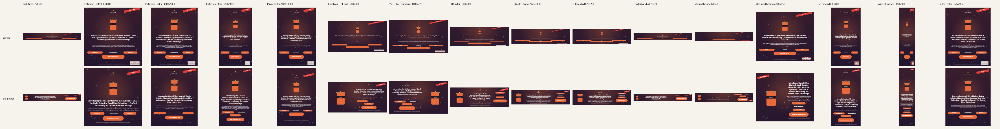

# Chameleon: rearrange, don't stretch

Our entry for **Project CHAMELEON** (Adobe University Hackathon, North America 2026). The engine takes a design and a target canvas. It returns the same elements re-laid-out for the new shape: it reads the design's structure, tries several layouts, measures each with the official renderer's font metrics, and keeps the best one.

- Deterministic Python. No model and no network, so it runs offline in the starter Docker image.
- 1–100 ms per resize on a laptop.
- Only `engine/` changed in the stage-one path. `engine/main.py`, `renderer/` and the `Dockerfile` are the starter's, untouched.



## Run it

```bash
python3.11 -m venv .venv && source .venv/bin/activate   # Python 3.10+
pip install -r requirements.txt                          # starter deps (Pillow + cr-renderer)
python -m engine.main                                    # input/*.json -> output/*_output.{json,png}
```

Docker, exactly as stage one scores it (the starter Dockerfile is unchanged and we add no dependencies):

```bash
docker build --platform linux/amd64 -t chameleon-engine .
docker run --rm --network none -v $(pwd)/input:/app/input -v $(pwd)/output:/app/output chameleon-engine
```

Extras (not part of the scored engine):

```bash
pip install -r requirements-dev.txt
python -m pytest -q                 # 194 tests
python -m tools.evaluate --render   # every sample x 15 platform formats, contact sheets in output/eval/
python -m tools.evaluate --input samples/extra   # 4 extra designs the engine was not tuned on
python -m studio.server             # demo UI at http://127.0.0.1:8765
```

## Supported input

The v0.9 design schema (`chameleon_design_schema_v0.9.json`): `text`, `image` and `shape` elements with geometry, `rotation`, `opacity`, `z_index`, `group_id` and the type-specific fields. You can pass a task file (`{source, target_canvas}`) or a bare design. Bad input degrades gracefully instead of crashing: missing fields, non-numeric values, unknown types, zero-size elements, missing assets, and empty element lists.

## How it works

```
source design ──► analyze ──► candidate layouts ──► score ──► best ──► finalize (clamp, refit) ──► design JSON
                  roles,       stack / split /       8 measurable
                  groups,      columns / strip /     criteria
                  order        proportional
```

1. **Analyze** (`engine/analyze.py`). The input has no semantic labels, so roles come from geometry.
   - The *background* is a cover image spanning the canvas.
   - *Decoration* is a translucent or free-standing shape.
   - *Groups* come from `group_id`, plus text sitting on a shape.
   - The *headline* is the largest type. *Fine print* is at most about 30% of the headline size and sits near an edge.
   - The *logo* is a wide, small image near the top. The *hero* is the largest image.
   - The *CTA* is the biggest button-like group. *Badges* are smaller ones, and badges sharing a row become one row block.
   - A *tag* is a badge hugging a corner. A *sticker* is a rotated group. An *unavailable* image is one whose asset isn't in the brand kit.
   - Each role has a priority, and every decision records a reason.
2. **Measure** (`engine/textfit.py`). This uses the renderer's own brand-font loader, Skia glyph widths and greedy wrap. When the engine says text fits, it fits in the PNG. Font sizes are whole numbers because the renderer truncates them.
3. **Lay out** (`engine/layout.py`). Rigid blocks (images, buttons, badge rows) scale uniformly, so proportions hold. Text reflows: same font family and copy, new width, measured size.
   - `stack`: one column in source reading order. Top and bottom anchors are kept, and the largest common scale is found by binary search.
   - `split-{left|right}-{40|50}`: hero on one side, message stacked beside it.
   - `columns`: hero | message | actions, for wide banners.
   - `strip-*`: one row for leaderboards. Only on canvases under 200 px tall, variants may drop the lowest-priority blocks (see Limitations).
   - `proportional`: uniform contain-scale, which suits near-identical ratios.
   - On canvases under 640 px on the short side, each strategy also runs as a *text-first* variant (images and buttons at 65%) and as variants that drop fine print, then long body copy, then badges. The headline, logo and CTA are never dropped, and neither is body text under 60 characters (usually a tagline or text CTA).
   - Banner heights (under 80 px tall) get extra care. Strips shrink pictures before the CTA and keep the logo at least 45% of the strip height. Small button labels may grow up to 1.3x to fill their box. As a last resort the product image may drop out so the message stays readable.
   - The scorer treats text under 5 px and images under 12 px as lost: they are in the JSON but nobody can see them.
   - **Dropping is a last resort.** A dropping layout can win only if no layout that keeps everything reaches readability 0.8. The report records this decision (`drop_rule`).
   - In one-row layouts, consecutive text pieces (eyebrow, headline, date, subtitle) stack into one text cell at a shared scale, instead of sitting side by side in narrow columns.
   - After layout, decorations keep their distance to their nearest corner and shrink away from text and buttons, with a small margin. An overlap that already existed in the source is kept as intentional layering. Stickers and tags go back to their original corner, or the nearest free one.
4. **Score** (`engine/score.py`). Readability, hierarchy kept, use of space, scale consistency, collisions, completeness, reading-order fidelity, and balance. These are our proxies for the brief's §2.5 criteria. Weights are in `WEIGHTS`.
5. **Finalize** (`engine/chameleon.py`). Clamp rotated bounds inside the canvas, re-fit any text whose box changed, and keep every id in source order. If anything throws, `resize()` falls back to a uniform contain-fit that is still valid (`safe_fit`).

`adapt()` also returns a report: roles with reasons, every candidate with its score breakdown and design, and before→after for each element. The Studio shows this report.

## Results on the starter samples

`python -m tools.evaluate` runs 3 samples × (task target + 15 formats) = 48 resizes. It reports **0 hard-rule problems** under our checks (`tools/checks.py`):

- Schema valid, same ids
- Box and rotated bounds on-canvas
- Image aspect within 5%
- Font family and copy unchanged
- Visible text fits its box at its font size

The slowest run took about 100 ms.

`samples/extra/` holds four designs we wrote to test structures the official samples lack: a landscape web hero with left-aligned copy, an editorial page with two images and a bottom logo, a text-only event poster on a solid shape, and a sale post with text overlapping the product. They gave 64 more runs with 0 hard-rule problems. They also exposed three bugs, now fixed: body copy misread as fine print, a bottom-corner logo not recognised, and left-aligned columns breaking apart. The scores we print are our own proxy, **not** Adobe's scorer.

## Limitations (honest list)

- **Left-aligned columns** that share a left edge in the source keep sharing one after reflow, so text and its button stay lined up.
- **Hiding on small canvases.** When no layout that keeps everything reads well, low-priority content may get `opacity: 0`: fine print, long body copy and badges, stickers on strips under 200 px tall, and the product image on banners under 80 px tall. Missing-asset images are always skipped ("skip it" is explicitly allowed for the Level 3 sample). The organisers haven't said whether hiding is acceptable for scoring, so `CHAMELEON_ALLOW_HIDE=0` turns it off and keeps everything visible.
- **The official renderer ignores `opacity` on text** (we verified this). Hidden text therefore also gets a transparent colour alpha, or it would still draw. Only hidden elements are affected, but it is a change to `color`.
- **Copy that is simply too long stays small.** Copy can't be rewritten in stage one. The Level 3 headline (140 characters) renders at 8 px on 320×50 and at 9 px on 728×90: readable, but small. Shortening copy is a finale idea we haven't built.
- **Roles are heuristics.** Unusual designs can be misread, such as two equally large headlines or a logo at the bottom. Every candidate still obeys the hard rules, and scoring picks the least bad, but the result may be plainer than a designer's.
- **Not done:** no copy rewriting or font-family changes (stage-one rules forbid them), no image cropping beyond `fit: cover` backgrounds, and no learned model.
- **Docker is unverified here.** Docker wasn't installed on the development machine. We added no dependencies, and the starter Dockerfile is unchanged.
- **The target catalogue is ours.** `tools/formats.py` is our own list of common sizes, used only for tests and the demo. The engine never special-cases a size.

## Repo map

| Path | What |
|---|---|
| `engine/resize.py` | The required entry point; calls `adapt()`, falls back to `safe_fit()` |
| `engine/{analyze,textfit,layout,score,chameleon}.py` | The engine |
| `tests/test_engine.py` | Hard rules × samples × formats, random designs, malformed input |
| `tools/` | Format catalogue, rule checks, batch evaluator |
| `studio/` | Local demo UI (stdlib server + one HTML file) |
| `CHALLENGE_NOTES.md`, `BUILD_PLAN.md`, `SUBMISSION.md` | Brief analysis, plan, pitch and demo pack |
| `STARTER_README.md`, `RULES.md`, `FAQ.md` | Organiser-provided starter docs |

Developed with AI coding assistance.
