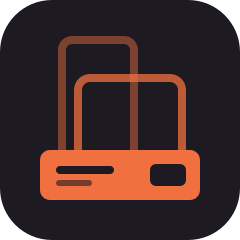
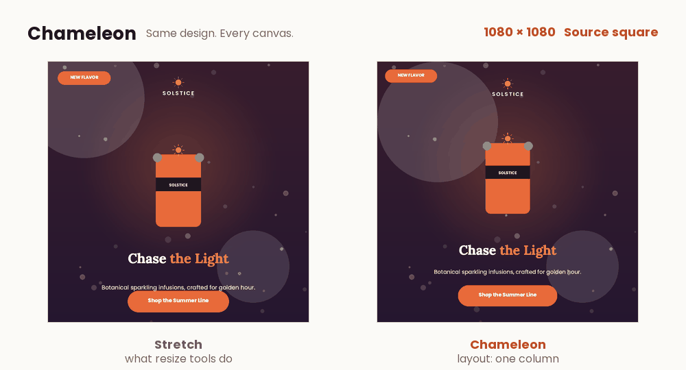
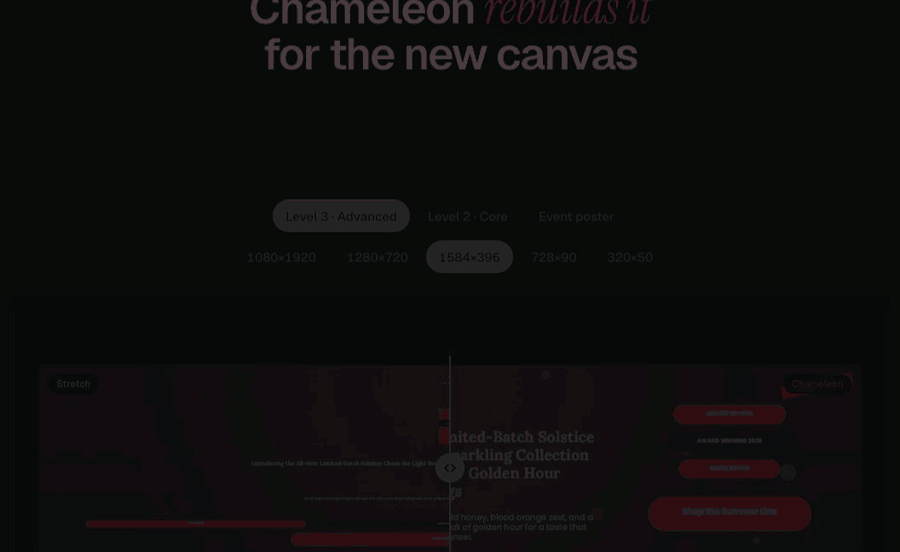
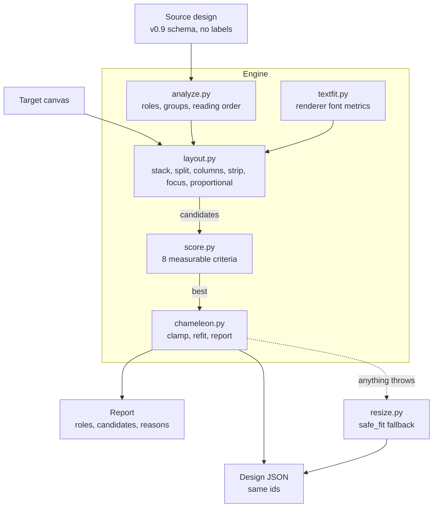
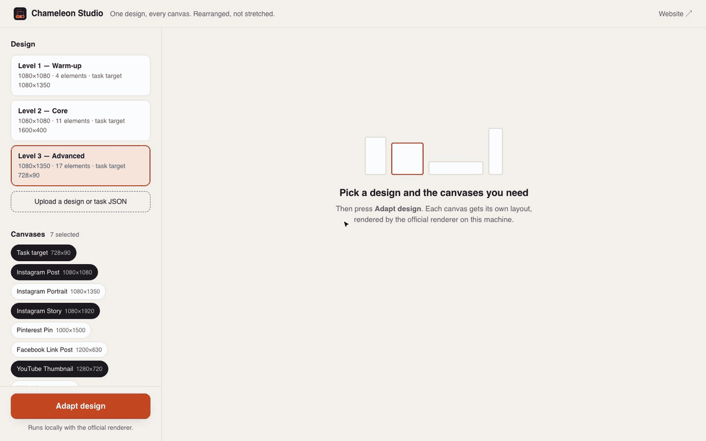
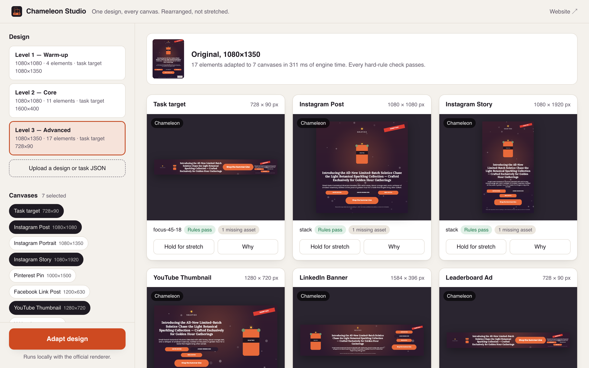
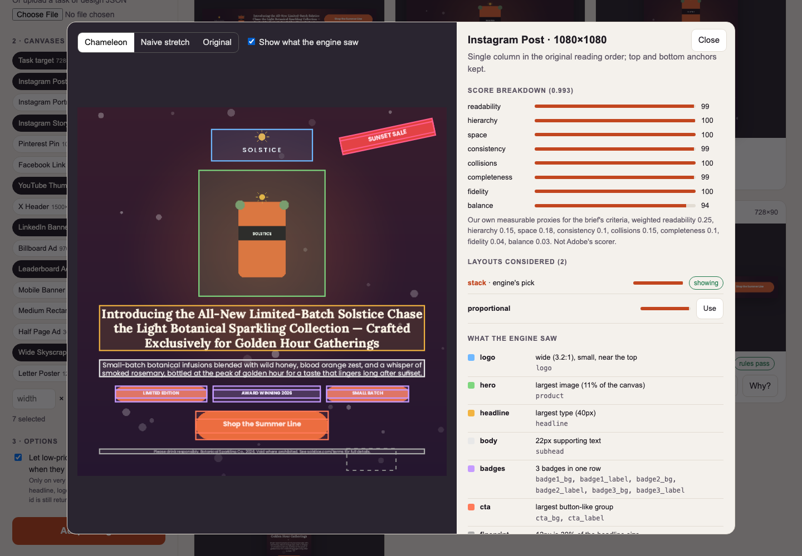
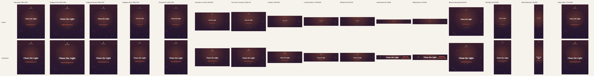
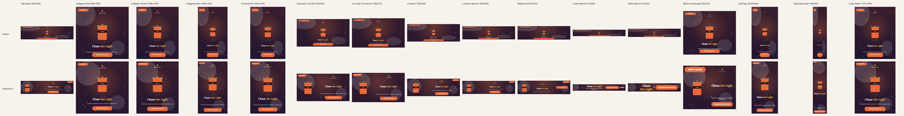

<div align="center">



# Chameleon


</div>

Live at [chameleon-resize.vercel.app](https://chameleon-resize.vercel.app).

**A designer finishes one poster, and marketing needs it as a story, a square, a YouTube thumbnail and a 728×90 banner. Chameleon rebuilds it for each canvas instead of stretching it. It works out what every piece of the design is from geometry alone, builds several real layouts for the new shape, measures each one with the official renderer's own fonts, and keeps the most readable. Every element comes back, and copy and fonts never change.**



*One design swept through every canvas from a story to a 320×50 banner. Left: what a plain resize does. Right: Chameleon. Every frame is a real engine result drawn by the official renderer.*

On the same 2,250 resizes of 150 random designs across 15 formats:

| | Stretch | Chameleon |
| --- | --- | --- |
| Every hard rule passes | 68 of 2,250 (**3%**) | 2,250 of 2,250 (**100%**) |
| Images keep their shape | 172 (**8%**) | 2,250 (**100%**) |
| Headline at 9 px or more | 1,790 (**80%**) | 2,228 (**99%**) |
| Headline and button both readable (6 px or more) | 1,519 (**68%**) | 2,188 (**97%**) |

**Team:** Volodymyr Borysenko and Mert Özkardeş, for Project CHAMELEON at the Adobe University Hackathon, North America 2026.

## The problem

Resize tools do one of two things. They **stretch** the design, so letters get pulled wide and short, round products stop being round and the logo looks off brand. Or they **crop** it, and the logo, the button or the fine print falls off the edge. The challenge brief puts it plainly: in Adobe Express this is "a real, currently unsolved problem inside the product".

A designer does neither. They **rearrange**: the headline moves beside the product, the badges become one row, the button stays big enough to tap. That takes knowing what each piece *is*, and the input file says nothing about that. It is a flat list of text, images and shapes with positions.

Stage one adds hard rules on top. Every element id comes back, nothing leaves the canvas, images keep their proportions, copy and fonts never change, and every element stays visible. The organisers confirmed the last one on October 22.

## How it works



*One real resize: the Level 3 poster becomes a 1584×396 LinkedIn banner. Every frame is the engine's own output.*

### 1. Read the design

The input has no labels, so `engine/analyze.py` reads roles from size, position and grouping. The largest type is the headline. A wide, small image near the top is the logo, and the largest image is the product. The biggest button-like group is the call to action; smaller ones are badges, and badges on one line become one row. A rotated group is a sticker. Small text near an edge is fine print. Every decision records its reason, so the report can say why the engine thought a piece was the logo.

### 2. Measure text the way the renderer draws it

`engine/textfit.py` loads the brand fonts through the renderer's own Skia loader and wraps text with the same greedy rule. When the engine says a line fits, it fits in the PNG. Font sizes are whole pixels because the renderer truncates them.

### 3. Build real layouts for the new shape

`engine/layout.py` builds a candidate for every layout that suits the shape. Images, buttons and badge rows scale uniformly, so nothing distorts. Text reflows at a new width with the same copy and font.

| Layout | When it's tried | What it does |
| --- | --- | --- |
| One column (`stack`) | Every shape | Source reading order top to bottom, at the largest common scale that fits. Tall canvases grow the column until it fills the height |
| Image beside text (`split`) | Landscape | Product on one side, the message stacked beside it |
| Three columns (`columns`) | Wide | Product, message and actions side by side |
| One row (`strip`) | Very wide | Everything in a row. On banners, long body copy and fine print get a small cell of their own |
| Headline-first row (`focus`) | Banner ads | Logo, product, headline and button in one row, with most of the width for the headline. Everything else stacks small at the end |
| Scaled as is (`proportional`) | Shapes close to the source | A uniform fit, offered only where it won't leave wide empty bands |

On small canvases each layout also runs in a text-first variant. On banners there are variants that draw secondary copy smaller so the headline and button get the room. Nothing is ever hidden.

<details>
<summary>Every layout rule in detail</summary>

- `stack` keeps top and bottom anchors and finds the largest common scale by binary search.
- On canvases much taller and narrower than the source, `stack` raises the common scale toward 86% of the height. It stops once free text would hit its size cap or change rank, so the headline stays the largest text and images never outgrow the copy. Spare height goes to the product image.
- `split-{left|right}-{40|50}` gives the product 40% or 50% of the width.
- `proportional` is offered only when the target's aspect ratio is within 30% of the source's.
- On canvases under 640 px on the short side, each layout also runs as a text-first variant with images and buttons at 65%.
- On banner heights (under 200 px), variants draw long body copy, fine print and badge rows at half size, and a column may grow past the area-based cap while it has spare height, under the same rank rules.
- `focus` is offered under 80 px tall, or under 120 px when the headline is longer than 60 characters. Where it is offered, three columns is not. Leaderboards (80 px and up) also try giving the headline only 45-50% of the row, so the product and button keep their size.
- Under 80 px tall, strips shrink pictures before the button, keep the logo at least 45% of the strip height, and let small button labels grow up to 1.3x to fill their box.
- In one-row layouts, consecutive text pieces (eyebrow, headline, date) share one cell at one scale instead of sitting in narrow columns.
- Decorations keep their distance to the nearest corner and shrink away from text and buttons. An overlap that existed in the source is kept as intentional layering. Stickers and tags go back to their corner, or the nearest free one.
- A layout whose text can't fit its box even at the smallest size is never chosen while a clean layout exists.

</details>

### 4. Score each layout and keep the best

`engine/score.py` scores every candidate on eight measurable terms: readability, hierarchy, use of space, scale consistency, collisions, completeness, reading order and balance. A headline or button label under 6 px costs a flat penalty, so the engine prefers a layout where both key messages can be read. The weights are in `WEIGHTS`. These are our stand-in for the brief's criteria. Adobe's own scorer isn't public.

### 5. Check every hard rule

`engine/chameleon.py` clamps rotated bounds inside the canvas, re-fits any text whose box changed and keeps every id in source order. If anything throws, `resize()` falls back to a plain uniform fit that still passes every hard rule. `adapt()` also returns a report: the roles with their reasons, every candidate with its score breakdown, and before and after for each element.



| Decision | Made by | Why |
| --- | --- | --- |
| What each element is | Geometry rules in `analyze.py` | The input has no labels. Size, position and grouping are all there is |
| How big text can be | The renderer's own fonts in `textfit.py` | If our measure differs from the renderer's, text overflows in the PNG |
| Which layouts to try | The canvas shape | A banner needs a row, a story needs a column. No size is special-cased |
| Which layout wins | The score in `score.py` | Eight measurable terms, so every choice can be explained and checked |
| What to drop | Nothing | Every element stays visible. Only an image whose asset file is missing is skipped |
| What to do on an error | `safe_fit` | A plain fit that passes every hard rule beats a crash |

## Try it

| What | How | Who it's for |
| --- | --- | --- |
| Landing page | [chameleon-resize.vercel.app](https://chameleon-resize.vercel.app) | Anyone. Drag across stretch and Chameleon, and watch one resize step by step. English, Spanish and French |
| Studio | `python -m studio.server`, then http://127.0.0.1:8765 | Designers and judges. Adapt one design to many canvases, hold to compare with stretch, open **Why** |
| The scored engine | `docker run` below | Judges. Exactly how stage one runs it, offline |
| Every check | `python -m pytest -q` and `python -m tools.evaluate` | Anyone who wants to verify the numbers |



*The Studio, recorded live: adapt one design to seven canvases, hold to compare with stretch, open Why, show the roles the engine found, and switch to another layout.*

<table><tr>
<td></td>
<td></td>
</tr></table>

## Results

### Against a plain stretch

The table at the top compares Chameleon with the starter's stretch on 150 random designs from `tools/stress.py`, each resized to 15 formats from 1080×1920 down to 320×50. The random designs vary headline length, alignment, logo position, the number of images, badges, ribbons and decorations. "Hard rules" are the checks in `tools/checks.py`: same ids, valid schema, boxes and rotated bounds on canvas, images within 5% of their proportions, copy and fonts unchanged, and visible text that fits its box.

### On the starter samples

`python -m tools.evaluate` runs the 3 samples on their own targets and 15 formats, 48 resizes. **0 hard-rule problems.** The slowest resize took under 100 ms.


*The Level 3 sample across 16 formats. Stretch on top, Chameleon below, both drawn by the official renderer.*

<table><tr>
<td></td>
<td></td>
</tr></table>

Level 3 is the hardest: 17 elements and a 140-character headline. On its own 728×90 target it now gets a 13 px headline and a 12 px button, up from 9 px and 8 px.

### On designs we never tuned on

`samples/extra/` holds four designs we wrote to test structures the samples lack: a landscape web hero with left-aligned copy, an editorial page with two images and a bottom logo, a text-only event poster, and a sale post with text over the product. They gave 64 more resizes with **0 hard-rule problems**. They also exposed three bugs, now fixed: body copy read as fine print, a bottom-corner logo not recognised, and left-aligned columns breaking apart.

### In the scoring container

`docker build --platform linux/amd64` and `docker run --network none` succeed with the unchanged starter Dockerfile, and all three samples pass every hard rule inside the container. Levels 1 and 2 match the macOS run byte for byte. Level 3 picks the same layout and font sizes, but its headline box is a few pixels wider. The image ships Skia 144.1 and our Mac setup has 144.0, and text is measured with that Skia.

**200 tests** pass (`python -m pytest -q`): hard rules on every sample and format, random designs, and malformed input.

## How we meet the brief

The brief lists what the scoring rewards (PDF §2.5), plus speed and reliability (`RULES.md`). No weights were published.

| Brief criterion | What we built | Evidence |
| --- | --- | --- |
| Rearrange, don't stretch | Six layout families that re-place blocks. Text reflows, rigid blocks scale uniformly | `engine/layout.py`, `docs/sheet_*.png` |
| No unwanted collisions | Columns and rows can't overlap by construction. Stickers find a free corner, decorations shrink away from text, and collisions are scored | `test_no_collisions_between_visible_content` |
| Everything readable, nothing cut off | Text measured with the renderer's fonts and wrap. Readability is scored, with a floor for the headline and button. Nothing is hidden | `engine/textfit.py`, `tools/checks.py` |
| On brand | Font family, copy, colours, assets, z-order and groups unchanged. The logo keeps its proportions | `tools/checks.py` |
| Looks intentional | Shared margins and gaps, source reading order, the headline keeps its lead, consistent scale | `engine/score.py` |
| Holds up everywhere | Only generic rules, never keyed to a size or a design | 200 tests, 2,250 random resizes |
| Valid, honest JSON | Same ids, required fields, schema validation, rotated bounds on canvas | `tools/checks.py` |
| Speed and reliability | Deterministic, under 100 ms per resize, no model or network, a safe fallback | `python -m tools.evaluate` |

## Next to other resize tools

| | Keeps proportions | Rearranges for the new shape | Every element kept | Explains each choice | No setup per design | Offline and open |
| --- | :---: | :---: | :---: | :---: | :---: | :---: |
| Stretch to the new size | ✗ | ✗ | ✓ | ✗ | ✓ | ✓ |
| Fit or crop | ✓ | ✗ | ✗ | ✗ | ✓ | ✓ |
| Canva Magic Switch | ✓ | Partly ¹ | Not stated | ✗ | ✓ | ✗ |
| Adobe Express Resize | ✓ | Partly ¹ | Not stated | ✗ | ✓ | ✗ |
| Figma constraints and auto layout | ✓ | Once set up | ✓ | ✗ | ✗ | ✗ |
| **Chameleon** | **✓** | **✓** | **✓** | **✓** | **✓** | **✓** |

¹ Both move elements automatically but don't publish how. Rows other than ours come from public product pages as of October 2026 ([Canva](https://www.canva.com/pro/magic-switch/), [Adobe Express](https://helpx.adobe.com/express/web/organize-your-designs/arrange-layers-and-pages/change-page-size.html)). This compares features, not results.

## What we learned

- **"Fits" has to mean fits in the renderer.** The renderer truncates font sizes, so 13.7 px draws as 13 px, and its wrap decides the line breaks. We measure with its own Skia fonts, wrap and whole-pixel sizes, so a line that fits in the JSON fits in the PNG.
- **A score can win by a hair and still look wrong.** On banners, three columns beat the headline-first row by about 0.01 while drawing the headline smaller than the button. Rather than nudging weights until it flipped, we stopped offering three columns where the headline-first row exists.
- **Penalties should be steps, not slopes.** A gradual penalty for small text traded 2 px of headline to move a button from 2 px to 4 px, which is still unreadable. A flat penalty below 6 px only trades when both messages become readable. On 320×50 banners, designs with both readable went from 34 to 91 of 128.
- **Hiding is the easy way out.** Dropping low-priority copy made tiny banners look clean, but the organisers asked for every element to stay. Squeezing secondary copy into a small end cell kept everything and still let the headline lead.
- **Check inside the container.** Docker ships a different Skia build than our Mac, which moved one headline by a few pixels. Every engine change now runs through the hard-rule checks inside the scoring image.

## Limits

- **Very dense copy on tiny canvases gets small type.** Copy can't be rewritten in stage one and nothing may be hidden. Level 3's 140-character headline is 8 px on 320×50 and its button text 3 px. Simpler designs stay readable at those sizes.
- **Roles are inferred.** An unusual design, such as two equally large headlines, can be misread. Every candidate still obeys the hard rules, but the result can be plainer than a designer's.
- **Not done:** no copy rewriting or font changes (stage-one rules forbid them), no cropping beyond `fit: cover` backgrounds, and no learned model.
- **One exception to "nothing hidden":** an image whose asset file is missing (Level 3's `holiday_watermark`) is skipped, as the brief allows. `CHAMELEON_ALLOW_HIDE=1` turns on an old opt-in mode that may hide unreadable low-priority items. It is off by default.

## What's next

- **An Adobe Express add-on.** The report already has everything a designer needs, so the add-on sends the page, gets every canvas back and lets the designer pick another candidate per canvas.
- **Shorter approved copy for tiny canvases.** On a 320×50 banner a shorter headline beats any layout. Stage one forbids it, so it's first on the list after.
- **Learning from the designer.** The Studio already lets you swap the winning layout. Those swaps can tell us which score weights designers actually prefer.

## Run it

```bash
python3.11 -m venv .venv && source .venv/bin/activate   # Python 3.10+
pip install -r requirements.txt                          # the starter's deps: Pillow and cr-renderer
python -m engine.main                                    # input/*.json -> output/*_output.{json,png}
```

Docker, exactly as stage one runs it. The starter Dockerfile is unchanged and we add no dependencies.

```bash
docker build --platform linux/amd64 -t chameleon-engine .
docker run --rm --network none -v $(pwd)/input:/app/input -v $(pwd)/output:/app/output chameleon-engine
```

Checks and extras, not part of the scored engine:

```bash
pip install -r requirements-dev.txt
python -m pytest -q                              # 200 tests
python -m tools.evaluate --render                # every sample x 15 formats, contact sheets in output/eval/
python -m tools.evaluate --input samples/extra   # 4 designs the engine was not tuned on
python -m tools.stress --n 150                   # 150 random designs x 15 formats (2,250 resizes)
python -m studio.server                          # the Studio at http://127.0.0.1:8765
python -m tools.build_site                       # rebuild the landing page from current renders
```

- **No model, no weights, no network, no GPU.** The engine is rule-based and scored. It uses the Python standard library plus the renderer's Skia font loader, and falls back to a built-in width estimate if that import fails.
- **Run-time materials:** `brand_kit/fonts` for text metrics and `brand_kit/assets` to know which images exist. The Dockerfile already copies both.
- **Input:** the v0.9 schema (`chameleon_design_schema_v0.9.json`), as a task file (`{source, target_canvas}`) or a bare design. Bad input degrades gracefully: missing fields, non-numeric values, unknown types, zero-size elements, missing assets and empty element lists.

## Code map

| Path | What |
| --- | --- |
| `engine/resize.py` | The required entry point. Calls `adapt()` and falls back to `safe_fit()` |
| `engine/analyze.py` | Roles, groups and reading order from geometry |
| `engine/textfit.py` | Text measuring with the renderer's fonts |
| `engine/layout.py` | The candidate layouts |
| `engine/score.py` | The eight score terms and their `WEIGHTS` |
| `engine/chameleon.py` | `adapt()`: runs the pipeline, finalizes and builds the report |
| `engine/main.py` | The starter's batch runner, unchanged |
| `tests/test_engine.py` | Hard rules on every sample and format, random designs, malformed input |
| `tools/` | Format catalogue, rule checks, evaluator, stress generator, site builder, animation (`make_gif.py`) |
| `studio/` | The Studio: a standard-library server, `index.html` and `style.css` |
| `site/` | The landing page: `template.html`, `style.css` and `i18n.json`, built into `index.html` |
| `samples/extra/` | Four designs the engine was not tuned on |
| `docs/` | Contact sheets, Studio recordings and screenshots, animations, logo |
| `STARTER_README.md`, `RULES.md`, `FAQ.md` | The organisers' starter docs |

Developed with AI coding assistance.
