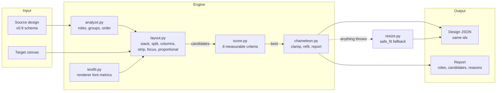
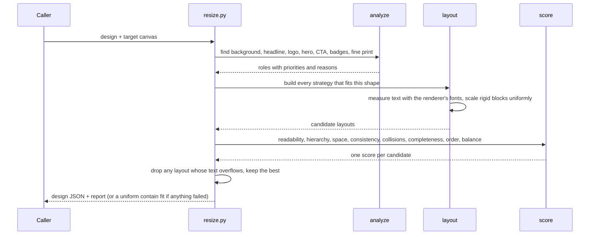

<div align="center">


# Chameleon

**Rearrange, don't stretch.** Chameleon takes one finished design and lays it out again for any canvas. It reads the
design's structure from **geometry alone**, builds **several real layouts** for the new shape, measures each one with the
**official renderer's own font metrics**, and keeps the one that stays readable. **Every element comes back. Copy and
fonts never change.**

<br/>


<br/>


<sub>The Level 3 sample across 16 formats. Naive stretch on top, Chameleon below. Both rendered by the official renderer.</sub>

</div>

---

**Hackathon:** Adobe University Hackathon, North America 2026 (Oct 5 to 30, 2026)<br/>
**Challenge:** Project CHAMELEON, intelligent resizing for Adobe Express<br/>
**Team:** Volodymyr Borysenko · Mert Özkardeş<br/>
**Landing page:** [chameleon-resize.vercel.app](https://chameleon-resize.vercel.app)<br/>
**Runs:** offline, deterministic, 1 to 230 ms per resize, in the unchanged starter Docker image

| Where | What you'll find |
|-------|------------------|
| [`engine/`](engine/) | The scored engine. `resize.py` is the required entry point |
| [Studio](#run-it) (`python -m studio.server`) | Local demo: many canvases at once, hold to compare with stretch, why each layout won, pick another layout |
| [Landing page](https://chameleon-resize.vercel.app) | The idea in one page, with renders from the real engine |
| [`SUBMISSION.md`](SUBMISSION.md) | Pitch, 75 second demo script, how each judging criterion is met |
| [`docs/`](docs/) | Contact sheets for all three samples and Studio screenshots |

---

## The Problem

Marketing makes one poster. Then it needs a story, a square post, a YouTube thumbnail, a LinkedIn banner and a 728×90
leaderboard. Resize tools do one of two things:

- **Stretch.** Letters get pulled wide and short. Round products stop being round. The logo looks off brand.
- **Crop.** The logo, the button or the fine print falls off the edge.

A designer doesn't do either. They **rearrange**: the headline moves beside the product, the badges become a row, the
button stays big enough to tap. That takes judgement about what each piece *is*, and the input has **no labels** at all.
It is a flat list of text, images and shapes with positions.

Stage one adds hard rules on top: same element ids, everything on canvas, images keep their proportions, copy and fonts
never change, and **every input element stays visible** (confirmed by the organisers on Oct 22).

**Chameleon does that rearranging automatically**, in milliseconds, and explains every decision it makes.

---

## Built With

| Area | Stack |
|------|-------|
| **Engine** | Python 3.10+, standard library only. No model, no weights, no network, no GPU |
| **Text measuring** | The renderer's own Skia brand font loader, glyph widths and greedy wrap. Falls back to a built-in width estimate if the import fails |
| **Rendering** | The starter's `cr-renderer` and Pillow, unchanged (`requirements.txt`) |
| **Checks and tests** | pytest and jsonschema (`requirements-dev.txt`), our own hard-rule checker (`tools/checks.py`) |
| **Studio** | Standard library HTTP server plus one HTML file. No framework, no build step |
| **Landing page** | Static HTML built from current renders by `tools/build_site.py`, hosted on Vercel |
| **Packaging** | The starter `Dockerfile`, unchanged. We add no dependencies |

---

## Architecture at a Glance



### One resize, start to finish



---

## How It Works

1. **Analyze** (`engine/analyze.py`). The input has no semantic labels, so roles come from geometry.
   - The *background* is a cover image spanning the canvas.
   - *Decoration* is a translucent or free-standing shape.
   - *Groups* come from `group_id`, plus text sitting on a shape.
   - The *headline* is the largest type. *Fine print* is at most about 30% of the headline size and sits near an edge.
   - The *logo* is a wide, small image near the top. The *hero* is the largest image.
   - The *CTA* is the biggest button-like group. *Badges* are smaller ones, and badges sharing a row become one row block.
   - A *tag* is a badge hugging a corner. A *sticker* is a rotated group. An *unavailable* image is one whose asset isn't in the brand kit.
   - Each role has a priority, and every decision records a reason.
2. **Measure** (`engine/textfit.py`). This uses the renderer's own brand-font loader, Skia glyph widths and greedy wrap. When the engine says text fits, it fits in the PNG. Font sizes are whole numbers because the renderer truncates them.
3. **Lay out** (`engine/layout.py`). Rigid blocks (images, buttons, badge rows) scale uniformly, so proportions hold. Text reflows: same font family and copy, new width, measured size.
   - `stack`: one column in source reading order. Top and bottom anchors are kept, and the largest common scale is found by binary search.
   - `split-{left|right}-{40|50}`: hero on one side, message stacked beside it.
   - `columns`: hero | message | actions, for wide banners.
   - `strip-*`: one row for leaderboards. On canvases under 200 px tall, variants give fine print and long body copy their own narrow cell at a small size, so the headline gets the room.
   - `proportional`: uniform contain-scale. Only offered when the target's aspect ratio is within 30% of the source's, because on a very different shape it leaves wide empty bands.
   - On canvases much taller and narrower than the source (stories, skyscrapers), `stack` raises the common scale until the column fills about 86% of the height. It stops as soon as text would hit its size cap or change rank, so the headline stays the largest text and images never outgrow the copy. Spare height after that goes to the product image.
   - On canvases under 640 px on the short side, each strategy also runs as a *text-first* variant (images and buttons at 65%). On banner heights (under 200 px) there are also variants that draw long body copy, fine print and badge rows at half size, so the headline and button get the room. Nothing is hidden.
   - On banner heights, a column may also grow past the area-based size cap while it has spare height, under the same rules as tall canvases (text keeps its rank, images never outgrow the copy).
   - `focus`: on banner-ad heights (under 80 px), a headline-first row. Logo, product, headline and button share one row with most of the width going to the headline. Secondary copy, badges and stickers stack small in an end column. Nothing is hidden.
   - A layout whose visible text can't fit its box even at the smallest size is never chosen while a clean layout exists.
   - Banner heights (under 80 px tall) get extra care. Strips shrink pictures before the CTA and keep the logo at least 45% of the strip height. Small button labels may grow up to 1.3x to fill their box.
   - The scorer treats text under 5 px and images under 12 px as lost: they are in the JSON but nobody can see them.
   - **Every element stays visible.** The organisers confirmed this at the Oct 22 info session. The only element ever skipped is an image whose asset file is missing, which the brief allows.
   - In one-row layouts, consecutive text pieces (eyebrow, headline, date, subtitle) stack into one text cell at a shared scale, instead of sitting side by side in narrow columns.
   - After layout, decorations keep their distance to their nearest corner and shrink away from text and buttons, with a small margin. An overlap that already existed in the source is kept as intentional layering. Stickers and tags go back to their original corner, or the nearest free one.
4. **Score** (`engine/score.py`). Readability, hierarchy kept, use of space, scale consistency, collisions, completeness, reading-order fidelity, and balance. These are our proxies for the brief's §2.5 criteria. Weights are in `WEIGHTS`.
5. **Finalize** (`engine/chameleon.py`). Clamp rotated bounds inside the canvas, re-fit any text whose box changed, and keep every id in source order. If anything throws, `resize()` falls back to a uniform contain-fit that is still valid (`safe_fit`).

`adapt()` also returns a report: roles with reasons, every candidate with its score breakdown and design, and before→after for each element. The Studio shows this report.

<div align="center">

<table align="center"><tr>
<td align="center"></td>
<td align="center"></td>
</tr></table>

<sub>The Studio. Left: one design, seven canvases. Right: what the engine saw, the layouts it tried and why one won.</sub>

</div>

**Who decides what**

| Decision | Made by | Why |
|----------|---------|-----|
| What each element is | Geometry rules in `analyze.py` | The input has no labels. Size, position and grouping are all there is |
| How big text can be | The renderer's own fonts in `textfit.py` | If our measure differs from the renderer's, text overflows in the PNG |
| Which layouts to try | The canvas shape | A leaderboard needs a row, a story needs a column. No size is special-cased |
| Which layout wins | The score in `score.py` | Eight measurable terms, so every choice can be explained and checked |
| What to drop | Nothing | Every input element stays visible. Only an image with a missing asset file is skipped |
| What to do on an error | `safe_fit` | A plain uniform fit that still passes every hard rule beats a crash |

---

## Results

### On the starter samples

`python -m tools.evaluate` runs 3 samples × (task target + 15 formats) = **48 resizes**. It reports **0 hard-rule
problems** under our checks (`tools/checks.py`):

- Schema valid, same ids
- Box and rotated bounds on-canvas
- Image aspect within 5%
- Font family and copy unchanged
- Visible text fits its box at its font size

The slowest run took about **230 ms** (the 320×50 banner tries the most variants).

<table align="center"><tr>
<td align="center"></td>
<td align="center"></td>
</tr></table>

### Stress and unseen designs

- **Random designs.** `python -m tools.stress --n 150` generates 150 random but realistic designs: varied headline
  lengths, left or centred text, logo top, bottom or corner, one or two images, badges, ribbons and decorations. It runs
  each through 15 formats, **2,250 resizes** in all, with **0** structural problems. The weakest results are all 320×50
  banners with very long headlines.
- **Designs we didn't tune on.** `samples/extra/` holds four designs we wrote to test structures the official samples
  lack: a landscape web hero with left-aligned copy, an editorial page with two images and a bottom logo, a text-only
  event poster on a solid shape, and a sale post with text overlapping the product. They gave **64** more runs with
  **0** hard-rule problems. They also exposed three bugs, now fixed: body copy misread as fine print, a bottom-corner
  logo not recognised, and left-aligned columns breaking apart.
- **Tests.** `python -m pytest -q`: **196 passed**. Hard rules × samples × formats, random designs, malformed input.
- **Docker.** `docker build --platform linux/amd64` and `docker run --network none` succeed on an Apple Silicon Mac
  (Colima, amd64 emulation). The container's output JSON for all three samples is **identical** to the macOS run.
  Last verified **Oct 29**.

The scores we print are our own proxy, **not** Adobe's scorer.

---

## Path to the Finale

- **Adobe Express add-on.** The engine already returns a full report, so the add-on is a thin layer: send the current
  page, get every canvas back, let the designer pick a different candidate per canvas. Not started yet.
- **Shorter copy for tiny canvases.** Stage one forbids rewriting copy. On a 320×50 banner, a shorter approved headline
  would beat any layout. This is the first thing we'd add.
- **Designer in the loop.** The Studio already lets you swap the winning layout for any other candidate. The next step
  is learning from those swaps which score weights designers actually prefer.
- **Any size.** The engine has no list of sizes inside it. `tools/formats.py` is only our test catalogue.

---

## Run It

```bash
python3.11 -m venv .venv && source .venv/bin/activate   # Python 3.10+
pip install -r requirements.txt                          # starter deps (Pillow + cr-renderer)
python -m engine.main                                    # input/*.json -> output/*_output.{json,png}
```

Docker, exactly as stage one scores it (the starter Dockerfile is unchanged and we add no dependencies):

```bash
docker build --platform linux/amd64 -t chameleon-engine .
docker run --rm --network none -v $(pwd)/input:/app/input -v $(pwd)/output:/app/output chameleon-engine
```

Extras (not part of the scored engine):

```bash
pip install -r requirements-dev.txt
python -m pytest -q                 # 196 tests
python -m tools.evaluate --render   # every sample x 15 platform formats, contact sheets in output/eval/
python -m tools.evaluate --input samples/extra   # 4 extra designs the engine was not tuned on
python -m tools.stress --n 150      # 150 random realistic designs x 15 formats (2,250 runs)
python -m studio.server             # demo UI at http://127.0.0.1:8765
python -m tools.build_site          # rebuild the landing page (site/index.html) from current renders
```

The landing page is static, built from `site/template.html` by `tools/build_site.py`, and deployed with
`cd site && vercel deploy --prod`.

### Models and dependencies

- **No ML model and no weights.** The engine is rule-based and scored, so there is nothing to download, host or fine-tune. Nothing runs on a GPU.
- **Runtime dependencies** are the starter's only: `Pillow` and `cr-renderer` (see `requirements.txt`). The engine itself uses the Python standard library, plus the renderer's Skia font loader to measure text. If that import fails, it falls back to a built-in width estimate.
- **Fixed materials used at run time:** `brand_kit/fonts` (for text metrics) and `brand_kit/assets` (to know which images exist). The Dockerfile already copies both.
- **Dev only:** `requirements-dev.txt` (pytest, jsonschema) for tests and tools.
- **Hardware:** any CPU. Runs offline with `--network none`.
- **Switch:** `CHAMELEON_ALLOW_HIDE=1` re-enables the old opt-in mode that may hide unreadable low-priority items (off by default, see Limits).

### Supported input

The v0.9 design schema (`chameleon_design_schema_v0.9.json`): `text`, `image` and `shape` elements with geometry, `rotation`, `opacity`, `z_index`, `group_id` and the type-specific fields. You can pass a task file (`{source, target_canvas}`) or a bare design. Bad input degrades gracefully instead of crashing: missing fields, non-numeric values, unknown types, zero-size elements, missing assets, and empty element lists.

---

## Code Map

| Path | What |
|------|------|
| `engine/resize.py` | The required entry point; calls `adapt()`, falls back to `safe_fit()` |
| `engine/analyze.py` | Roles, groups and reading order from geometry |
| `engine/textfit.py` | Text measuring with the renderer's fonts |
| `engine/layout.py` | Candidate layouts: stack, split, columns, strip, focus, proportional |
| `engine/score.py` | The eight score terms and their `WEIGHTS` |
| `engine/chameleon.py` | `adapt()`: runs the pipeline, finalizes, builds the report |
| `engine/main.py` | Starter batch runner, unchanged |
| `tests/test_engine.py` | Hard rules × samples × formats, random designs, malformed input |
| `tools/` | Format catalogue, rule checks, batch evaluator, stress generator, site builder |
| `studio/` | Local demo UI (stdlib server + one HTML file) |
| `site/` | Landing page template and build |
| `samples/extra/` | Four designs the engine was not tuned on |
| `docs/` | Contact sheets, Studio screenshots, logo |
| `CHALLENGE_NOTES.md`, `BUILD_PLAN.md`, `SUBMISSION.md` | Brief analysis, plan, pitch and demo pack |
| `STARTER_README.md`, `RULES.md`, `FAQ.md` | Organiser-provided starter docs |

---

## Limits

- **Very dense designs on tiny canvases get small type.** Copy can't be rewritten in stage one, and nothing may be
  hidden. So the Level 3 poster (17 elements, a 140-character headline) renders its headline at 9 px on 728×90 and
  8 px on 320×50 (up from about 4 px before the mobile banner fix), with the fine print smaller still. Simpler designs
  stay readable at those sizes.
- **Nothing is hidden.** Every input element stays visible, as the organisers asked. The one exception is an image whose
  asset file is missing (the Level 3 `holiday_watermark`), which is skipped as the brief allows. The old opt-in hiding
  mode (`CHAMELEON_ALLOW_HIDE=1`) gives hidden text a transparent colour too, because the official renderer ignores
  `opacity` on text.
- **Left-aligned columns** that share a left edge in the source keep sharing one after reflow, so text and its button
  stay lined up.
- **Roles are heuristics.** Unusual designs can be misread, such as two equally large headlines or a logo at the bottom.
  Every candidate still obeys the hard rules, and scoring picks the least bad, but the result may be plainer than a
  designer's.
- **Not done:** no copy rewriting or font-family changes (stage-one rules forbid them), no image cropping beyond
  `fit: cover` backgrounds, and no learned model.
- **The target catalogue is ours.** `tools/formats.py` is our own list of common sizes, used only for tests and the
  demo. The engine never special-cases a size.

---

Developed with AI coding assistance.
